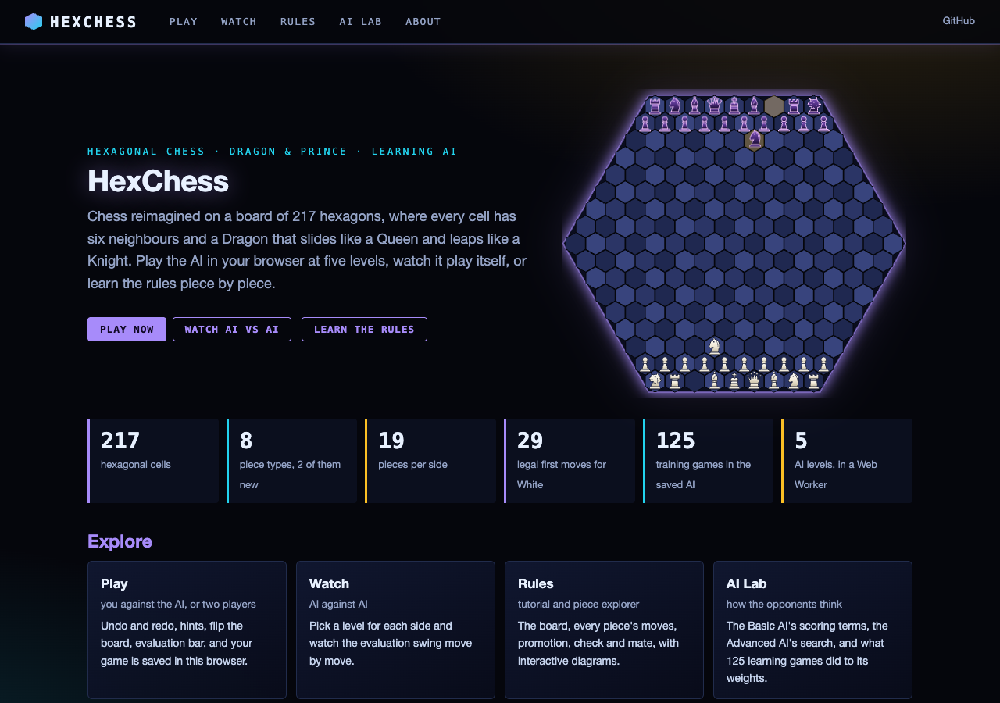
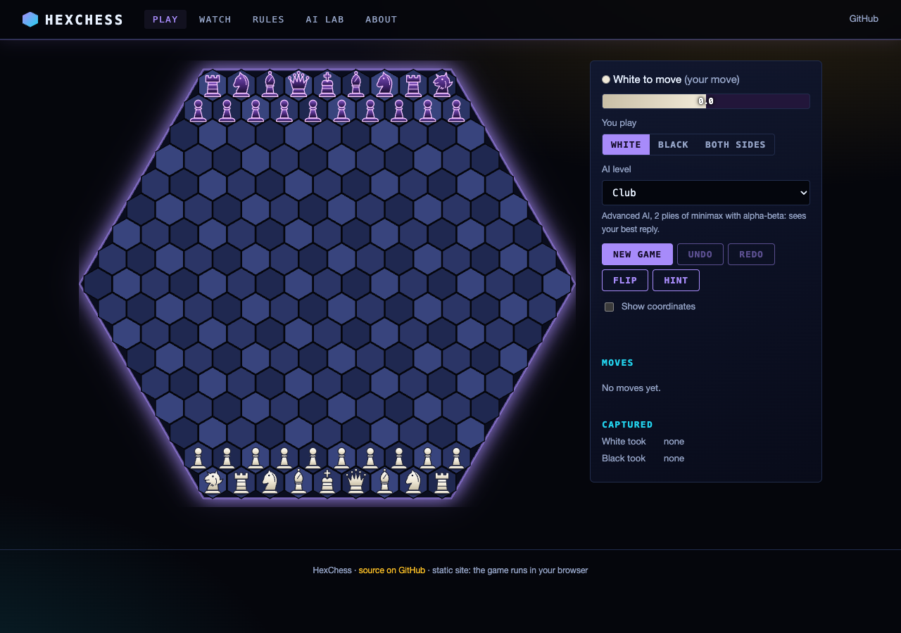
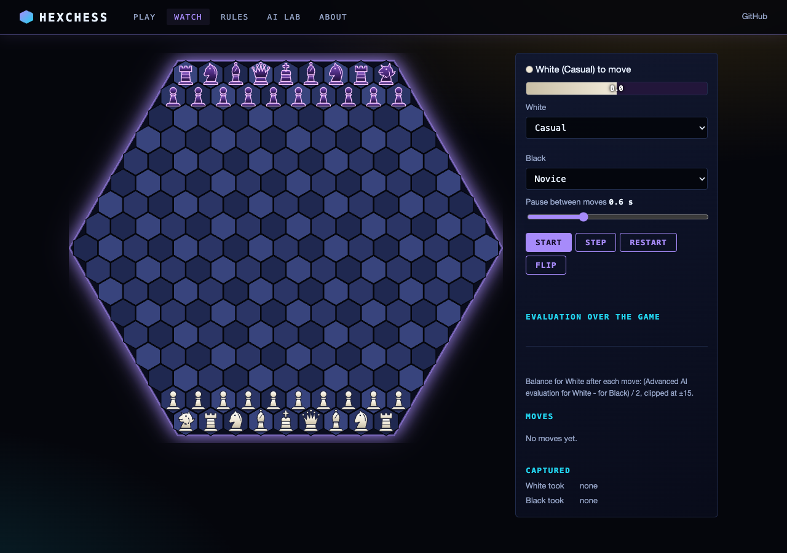
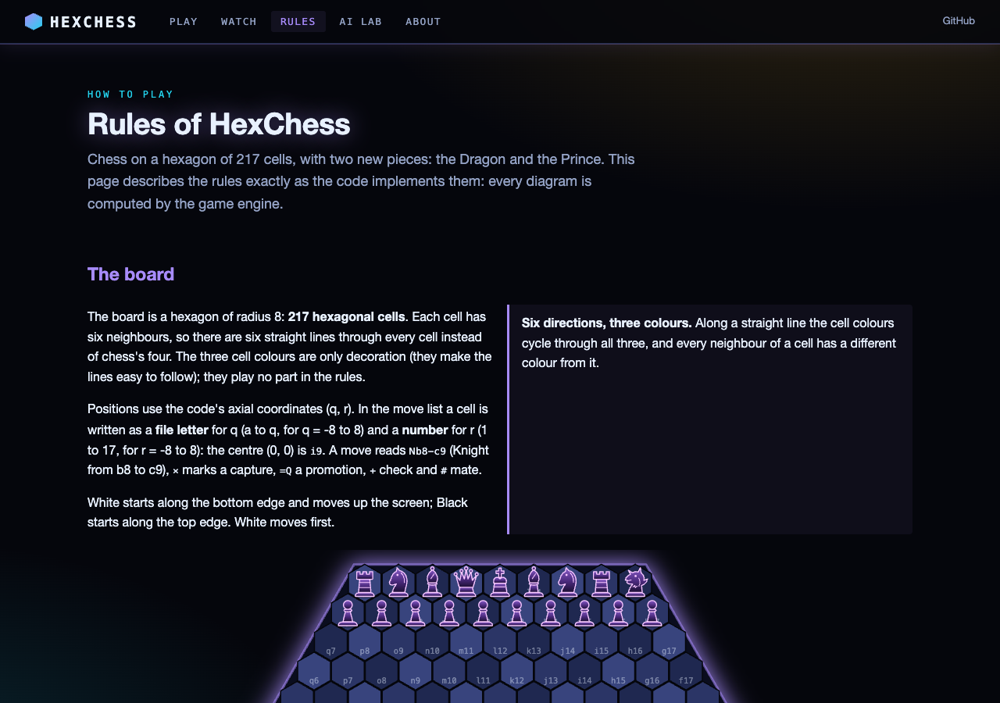
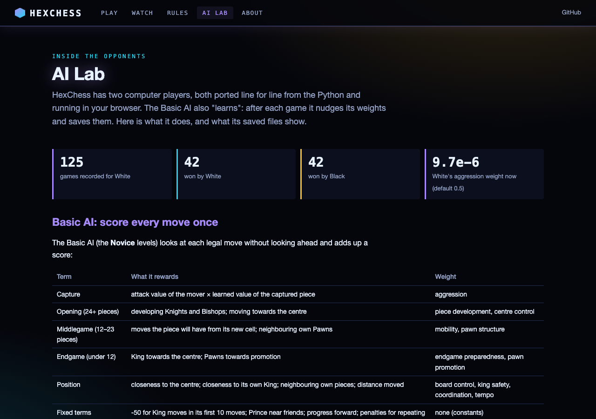

# HexChess

A PyQt5 hexagonal chess variant with custom pieces (Dragon, Prince), a learning AI system, and an interactive GUI with custom piece images and a help system.

## Features

- **Hexagonal board** with unique movement rules adapted for hex geometry
- **Custom pieces** -- Dragon and Prince in addition to standard chess pieces
- **Learning AI** that saves and loads parameters, with decision logging
- **Full game testing** and move validation
- **Check, checkmate and stalemate** enforced; pawns promote to Queen (far edge) or Prince (side edges)
- **Help system** with piece movement guides
- **Custom piece images** support

## Requirements

- Python 3.7+
- PyQt5, matplotlib

```bash
pip install -r requirements.txt
```

## Usage

```bash
python hexchess_main.py
```

## Project Structure

```
hexchess/
├── hexchess_main.py          # Application entry point
├── hexchess_gui.py           # MainWindow and board rendering
├── hexchess_game.py          # Game logic and rules
├── hexchess_board.py         # Hex board representation
├── hexchess_pieces.py        # Piece definitions (including Dragon, Prince)
├── hexchess_ai.py            # Learning AI with parameter persistence
├── hexchess_help.py          # Help system
├── hexchess_testing.py       # Game testing utilities
├── hexchess_tests.py         # Test suite
├── hexchess_full_game_test.py
├── ai_params_b.json          # AI parameters (black)
├── ai_params_w.json          # AI parameters (white)
├── web/                      # Web interface (FastAPI + JS ports of the engine and AIs)
└── scripts/                  # Static-site build, screenshots, JS-vs-Python fixtures
```

See INTERFACE.md for the full module map.

## Play in the browser

**https://gddickinson.github.io/hexChess/** -- the whole game runs in your browser (no server):

- **Play** against the AI at five levels (Basic AI with its learned or default weights; Advanced AI at 1 ply, 2 plies,
  or the desktop settings of 5 plies / 6 s), as White, Black or two players; undo/redo, hints, flip, coordinates,
  evaluation bar, move list with notation, and the game is saved in your browser.
- **Watch** AI against AI with a live evaluation graph.
- **Rules**: a tutorial of the rules as the code implements them, with an interactive piece explorer.
- **AI Lab**: how both AIs score positions, and what the 125 recorded learning games did to the weights.

The rules engine and both AIs are ported to JavaScript (`web/static/hex_engine.js`, `hex_ai_basic.js`,
`hex_ai_advanced.js`) and checked against the Python: `node web/static/hex_engine.test.mjs` replays games recorded by
`scripts/make_engine_fixtures.py` and requires identical legal-move lists, Basic AI scores and choices, and Advanced AI
searches. Pieces are drawn as SVG.







### Run the web app

```bash
pip install -r requirements-web.txt
python run_web.py                    # http://127.0.0.1:8231
python -m pytest -q tests            # includes the node engine test
python scripts/build_static.py       # static site in site/
```
